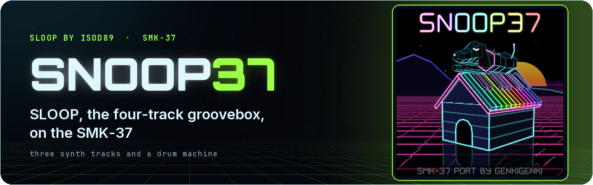
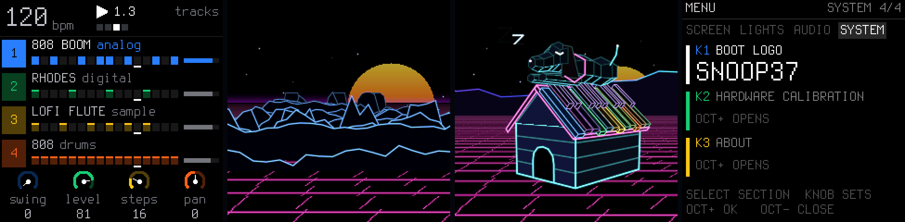

<p align="center"></p>

# Snoop37

Snoop37 — [SLOOP](https://github.com/isod89/sloop-fm1) by **isod89** for the M-Vave SMK-37, with an optional
look. The SMK-37 support is offered upstream: [#112](https://github.com/isod89/sloop-fm1/pull/112) (hardware),
[#130](https://github.com/isod89/sloop-fm1/pull/130) (look). Install:
<https://genkigenki.github.io/smk37/>


Snoop37 turns the SMK-37 MIDI keyboard into a stand-alone four-track groovebox: three synth tracks and a
drum machine, synthesised, played and sequenced on the keyboard's own chip. It is a port of [SLOOP](https://github.com/isod89/sloop-fm1) 2.7.1 by **isod89**, the
live groovebox firmware for the M-Vave FM-1, which in turn is based on
[Felucca](https://github.com/hugelton/Felucca) by **Leo Kuroshita / Hügelton Instruments**. The FM-1 and the
SMK-37 share the same JieLi AC791N (WL82) chip, boot chain and update loader; only the panel wiring differs.
This branch adds the SMK-37 board support (keys, pads, faders, wheels, knobs, display, LEDs, flash map,
installer) and the optional look (animated intro and boot jingle).

> **Status: experimental. Snoop37 2.7.2, based on SLOOP 2.7.1** (0.1.x was tested on an SMK-37 Pro). Unofficial
> firmware, not affiliated with or endorsed by M-Vave. Install at your own risk and read [Safety](#safety) first.

Everything SLOOP does is described in [README-SLOOP.md](README-SLOOP.md) (SLOOP's own README),
[GUIDE.md](GUIDE.md) and [SLOOP.md](SLOOP.md).

## What's new in 2.7

**2.7.2** adds **PAD LIGHT** (HOME menu > LIGHTS, K8): the pads at 100 % (default, as before), 75 %, 50 % or 25 %.
The bright states follow it and the dim ones keep most of their light, so at 25 % an empty step or an idle pad is
still plain to see and still apart from a lit one.

**2.7.1** takes SLOOP 2.7.1's fix: a second core that runs late is now held the safe way (after Felucca
1.6.1), so the music goes on, on one core, instead of a FELUCCA CRASH screen and a restart. A crash screen, if one
ever appears, also shows the stack and the second core's state and stays 10 s.

Snoop37 2.7.0 moves to SLOOP 2.7 (SLOOP's own list: [README-SLOOP.md](README-SLOOP.md#whats-new-in-27)). On the
SMK-37 that brings:

- **Two cores:** the sound runs on both of the chip's cores, so many voices and INSERT effects no longer crackle
  (HOME menu > SYSTEM > 2ND CORE, on by default). The supplies are set at M-Vave's own levels for two cores.
- **Fifteen arp modes**, **KBD HOLD**, **drum TUNE / DECAY** (DRUMS screen, SOUND page), **favourite sounds**,
  **looping samples**, **QUANT off** on the REC screen, overdub over held notes, **GLO > MIDI 3** (FX CH, DR MAP,
  REMOTE, CLOCK OUT), CC 74 per engine, KNOB ACCEL and LEVEL / PAN glide, USB RATE, your own screen colours (the
  editor's Theme page) and the editor's LIVE page.
- The SMK-37 settings (KEY VELOCITY, TRS MIDI OUT, BEND UP / DOWN, LIMITER, KNOB LAYOUT, BOOT LOGO) are kept in an
  object of their own now, since SLOOP 2.7 uses the room they had; the values of 2.6.x are taken over at the first
  start. The HOME menu: SCREEN (COLOR, ZOOM, KNOB LAYOUT, BOOT LOGO), LIGHTS (LIGHTS, KEYS, NOTES, PAD LIGHT), AUDIO (SPEAKER LOWCUT, USB AUDIO,
  USB RATE, LIMITER), PLAY (KEY VELOCITY, BEND UP, BEND DOWN, KNOB ACCEL), MIDI, DAW, SYSTEM (2ND CORE, HARDWARE
  CALIBRATION, MIDI LEARN CLEAR, ABOUT).
- SYSTEM's about screen shows `2.7.2 (SLOOP 2.7.1)`. Projects, presets, samples and kits of 2.6 load as they are.

## What's new in 2.6

Snoop37 2.6 moves to SLOOP 2.6 (changes: [CHANGES.md](CHANGES.md); SLOOP's own list:
[README-SLOOP.md](README-SLOOP.md#whats-new-in-26)). On the SMK-37 that brings:

- **27 punch-in effects:** hold FX; the pads are the loops, stutter, tape stop and the rest as before, the black
  keys F#3–F#5 the eleven new ones (KILL LOW / MID / HIGH, REWIND, OCT UP, FLANGER, AUTO-PAN, FREEZE, LOOP 8T,
  MONO, FADE OUT). REV THROW / ECHO THROW: FX + OCTAVE− / OCTAVE+.
- **MIDI LEARN:** GLOBE + F#3, turn the SLOOP knob (K5–K8) you want, move a knob of your controller, GLOBE + F#3
  again. HOME menu (PATCH held) > SYSTEM > MIDI LEARN CLEAR forgets them.
- **Pitch bend and sustain pedal from MIDI IN** (range: GLO > MIDI 2 > BEND, 1–12 semitones). The SMK-37's own
  pitch wheel has its own range (HOME menu > PLAY > BEND UP / BEND DOWN, default 7 / 7) on the selected synth track.
- **A MIDI channel per track** (GLO > MIDI, in and out) and **MIDI IN on one channel** (GLO > MIDI 2 > IN).
- An **INSERT** effect on every track, **LFO 2** with tempo sync, **ENV SYNC**, ANALOG's filter as LP / BP / HP,
  a note's **LEN** and step velocity, **TEXTURE** (a looping bed under the mix), **live drum mutes** (PARA + a
  black key), step entry from a MIDI keyboard, Program Change, SAVE > PROJECT > ERASE, a bolder screen font and a
  look-ahead master limiter.
- SYSTEM's about screen shows `2.6.6 (SLOOP 2.6)` (2.6.1: without the repository link; the SMK-37 hardware
  support as in the upstream pull request #112; 2.6.2: HOME menu > AUDIO > VELOCITY; 2.6.3: KEY VELOCITY, the
  menu rows named K5–K8, the visualiser without the SNOOP and WATERFALL styles; 2.6.4: TRS MIDI OUT, BEND RANGE,
  the wheels in the hardware calibration; 2.6.5: LIMITER SOFT / CLASSIC, BEND UP / DOWN, KNOB LAYOUT, the pads
  DRUM KIT / STEPS; 2.6.6: DAW mode, the HOME menu's PLAY and MIDI sections).

**After updating from 0.1.x, check two settings once:** HOME menu > SYSTEM > **BOOT LOGO**, and GLO > MIDI 2 >
**IN** (the MIDI channel SLOOP listens on). SLOOP 2.6 stores the MIDI IN channel in the bits where 0.1.x kept the
boot logo, so a 0.1.x BOOT LOGO of SLOOP or NONE comes back as SNOOP37 with IN = CH 1 or CH 2. Set both once and
they stay. Projects, presets, samples and kits are kept; a project saved in 2.6 does not open in 0.1.x.

## Features on the SMK-37



Everything of SLOOP 2.7 (four tracks, the synthesis engines and sounds, drum kits, samples, song mode, parameter
locks, USB audio, MIDI clock, the menus and screens), mapped onto the SMK-37's controls:

- **37 velocity keys.** The middle 27 keys (F3–G5) are the FM-1's note keys (notes, steps, menus), now with
  velocity (the stock two-contact timing and the unit's own factory velocity curves). HOME menu > PLAY > **KEY VELOCITY**
  (K5) sets how keys and pads play: DYNAMIC (as played, default), SOFT (a light touch plays louder), HARD (loud needs
  a hard hit), FIXED 64 / 100 / 127 (every note at that velocity; 100 is the FM-1's). The 10 outer keys play notes on
  the synth tracks and drums on the drum track: C3 kick, D3 snare, E3 hat; G#5 cowbell, A5 open hat, B5 crash,
  C6 ride (black keys as their left white key).
- **16 RGB pads**, with velocity. On the PLAY screen they are the **DRUM KIT** (default): a pad a drum sound,
  whatever track is selected (orange, dim; bright while it sounds), so the keys play a synth and the pads the drums.
  **KNOB BANK + FADER BANK** switches them to **STEPS**: the selected track's 16 steps of the page in reading order
  (empty dim white, set in the track's colour, playhead white; tap to set / clear, `<` `>` the step page), and back.
  Held layers keep their pads: steps, effects, mix and song tiles (SEQ, FX, GLO, SAVE), a piano for SCALE.
- **Pad sound picker.** Turning PRESETS (K4; K7 in the SMK knob layout) shows the sounds of one kind on the pads and the screen for a moment; a
  pad picks one and plays a short preview, `<` `>` page. KNOB BANK pins the picker open.
- **4 faders with banks.** FADER BANK cycles A level, B filter (low-pass – open – high-pass), C reverb, D delay for
  the four tracks (track 4 = drums); a fader takes over once it is moved. FADER BANK opens a screen with the four
  banks and what each fader sets; pressed again, `<` `>` or SELECT (K2) change the bank. It closes after 4 s or with PATCH.
  Only one bank screen is up at a time: KNOB BANK (pad picker) and FADER BANK close each other.
- **Wheels.** Pitch wheel: pitch bend on the selected synth track, HOME menu > PLAY > **BEND UP** (K6) and
  **BEND DOWN** (K7): OFF, 1, 2, 3, 4, 5, 7 or 12 semitones each way (default 7 / 7). Mod wheel: vibrato (10 Hz, up to ±1 semitone). Both calibrate themselves;
  the hardware calibration (OCTAVE− + OCTAVE+ at power-on) also teaches them, for the full range on the full travel.
- **TRS MIDI OUT.** The 3.5 mm jack sends the same MIDI as USB (keys, pads, sequencer), with or without a computer:
  HOME menu > MIDI > **TRS MIDI OUT** (K5), ON by default. A TRS-to-DIN adapter, type A (if a synth does not
  respond, try type B).
- **DAW mode.** `<` + `>` together (or HOME menu > MIDI > **MODE**) make the keyboard a MIDI controller and back:
  the keys play notes on CHANNEL, the knobs, faders, pads, buttons and wheels send CC, notes, MMC or pitch bend as
  a map says (a default one, or your own: PATCH held + OCTAVE+ on the keyboard, or the web editor's DAW MAP tab);
  KNOB BANK / FADER BANK / both switch banks A / B; PATCH: LOCAL ON / OFF (the keys also play SLOOP, or not). The
  map, the defaults and the controls: [SMK37.md](SMK37.md#daw-mode).
- **8 knobs as the FM-1's top row:** K1 master volume, K2 SELECT (tempo, pages), K3 track, K4 sound / kit,
  K5–K8 the four dials on the screen. One encoder step per detent. HOME menu > SCREEN > **KNOB LAYOUT** = SMK puts
  the dials on K1–K4, master volume on K5, SELECT on K6, sound / kit on K7, track on K8.
- **Limiter.** HOME menu > AUDIO > **LIMITER** (K8): SOFT (default; held chords keep their level, turn MASTER up for
  loudness) or CLASSIC (SLOOP's).
- **Buttons** keep SLOOP's functions (PATCH = HOME, PARA = EDIT, CHORD = ENV, NOTE REPEAT = LFO, SCALE = SEL,
  GLOBE = GLO, BT = SAVE, SEQ PLAY / SEQ REC = PLAY / REC); `<` and `>` walk pages, step pages (SEQ held) and
  visualiser styles; the ARP LED shows whether the selected track's arpeggiator runs.
- **Snoop37 look and sound** (build flag `SNOOP37=1`): an animated 3D intro (a neon doghouse with a piano-key
  roof, a low-poly beagle, a synthwave sun and grid, mountains that follow the music) with its own boot jingle
  (a small FM synth: a deep-note swell into D major, key bells, a final ping), fading into the UI; a key, pad or
  button press skips it. The firmware-update screens use the same scene. SYSTEM > BOOT LOGO picks the intro: SNOOP37, SLOOP or none.
- **Flash safety built in:** the firmware and its update loader write only to an explicit allow-list of flash
  ranges (checked at compile time and again in the flash driver); the factory calibration, Bluetooth pairing and
  key_mac areas are never written.

The full control map (FM-1 → SLOOP → SMK-37 → Snoop37) is in [docs/CONTROLS.md](docs/CONTROLS.md).
Not used yet: the pedal jack, pad pressure.

## Branches

| Branch | What |
| --- | --- |
| `snoop37` | Snoop37: SLOOP 2.7 + the SMK-37 support + the optional look (`SNOOP37=1`) |
| `smk37` | the SMK-37 support offered to SLOOP ([#112](https://github.com/isod89/sloop-fm1/pull/112)) |
| `smk37-snoop-look` | the look as an opt-in build flag, on top of `smk37` |
| `main` | SLOOP as upstream |

## Build

The JieLi toolchain is Linux x86-64 only: build on Linux or in WSL2 (Ubuntu) on Windows. See
[BUILDING.md](BUILDING.md) for details (macOS with Docker works as for SLOOP).

```sh
# once: the toolchain (to ~/.jieli/toolchain), the three AC79 SDK files, Python 3 with Pillow
sh tools/get_toolchain.sh
git clone --depth 1 --filter=blob:none --sparse --branch AC79NN_SDK_V1.2.1_2023-12-13 \
    https://gitee.com/Jieli-Tech/fw-AC79_AIoT_SDK.git ~/fw-AC79_AIoT_SDK
git -C ~/fw-AC79_AIoT_SDK sparse-checkout set cpu/wl82/tools
sudo apt install python3-pil        # or: pip3 install Pillow

# Snoop37 for the SMK-37 Pro -> build/sloop-smk37.fwsc (identity "SMK-37 Pro_900")
BOARD=smk37 SNOOP37=1 sh build.sh

# the plain SMK-37 port, without the intro and jingle
BOARD=smk37 sh build.sh

# without BOARD: SLOOP for the FM-1 (build/felucca.fwsc), byte-identical to upstream SLOOP 2.7
sh build.sh
```

`JIELI_TOOLCHAIN` and `AC79_SDK` override the default locations. The host tests run after an FM-1 build:
`sh build.sh && sh tests/run_tests.sh` (they include the SMK-37 flash-map, package, loader and installer
tests). One check, the static cost budget of `fm1_alnk0_irq`, fails the same way on unmodified SLOOP 2.7
(a stale budget file upstream).

## Install

**Easiest:** the web installer at [genkigenki.github.io/smk37](https://genkigenki.github.io/smk37/). Open it in
Chrome or Edge, connect the SMK-37 by USB, press Connect, then Install on Snoop37.

From a build:

1. Read [Safety](#safety) and back up the flash.
2. Connect the SMK-37 over USB and run SLOOP's installer (Python 3 with `mido` and `python-rtmidi`):

   ```sh
   python3 tools/fm1_install.py build/sloop-smk37.fwsc
   ```

   It finds the SMK-37's MIDI port, checks the model and the package, asks the running firmware (the stock one
   or Snoop37) to start the update loader and writes the package; then the keyboard restarts and the installed
   identity is checked. The web installer in `docs/webapp/installer/` has the same SMK-37 support.
3. Updating later works the same way. Projects, presets, samples and settings are kept.

**Roll back to the stock firmware:** install the official firmware for your model with M-Vave's own updater
(M-UPGRADE), or pass the official package to the installer: `python3 tools/fm1_install.py --force
SMK-37_Pro_016.fwsc` (it handles the stock package format). Snoop37 keeps the stock update identity, so the
stock tools see the keyboard as usual.

**If it does not boot:** after two failed starts the firmware opens its USB recovery screen (identity
`SMK-37 Pro_000`), where the installer can write a package again. After a third failed start it drops into the
chip's mask-ROM update mode (UBOOT), where the app area can be rewritten with a JieLi UBOOT tool.

## Safety

- **Experimental firmware, no warranty** (see the GPL-3.0). You install it at your own risk.
- **Back up the whole 1 MiB flash first**, over the chip's mask-ROM UBOOT mode (e.g. with `jl-uboot-tool`). The stock
  firmware has no way into UBOOT, so you need a USB_KEY dongle (as for the FM-1); with Snoop37 installed, hold
  OCTAVE− and OCTAVE+ for 5 seconds while stopped to enter it. Keep the dump private: it holds data unique to your
  unit.
- **Never write 0xC0000–0xC1FFF** (Bluetooth pairing and the factory key / pad calibration, "trimdata") **or
  key_mac (0xFF000–0xFFFFF)**, and leave the stock resources (0xF4000–0xFDFFF) alone. They are unique to each unit
  and cannot be recreated. Snoop37 itself never writes them (compile-time allow-list plus a check in the flash
  driver), but a manual UBOOT write can. When you restore with a UBOOT tool, write only the ranges you need.
- Power the keyboard from a reliable USB port during an update and do not unplug it while the update screen says so.

## License and credits

Snoop37 is free software under the **GNU General Public License v3.0** ([LICENSE](LICENSE)), like SLOOP and Felucca;
third-party parts keep their own licenses (see [LICENSING.md](LICENSING.md) and [LICENSES/](LICENSES)).

- **SLOOP** – isod89, <https://github.com/isod89/sloop-fm1> (the groovebox, its engines, sounds, UI, installer and
  tools; this repository is a fork of SLOOP).
- **Felucca** – Leo Kuroshita (@kurogedelic), Hügelton Instruments, <https://github.com/hugelton/Felucca> (the
  original open FM-1 firmware SLOOP is built on).
- **SMK-37 board support and the Snoop37 additions** – genkigenki.
- The CC0 instrument samples are by Versilian Studios (see `assets/samples-cc0/ATTRIBUTION.txt`).

M-Vave, SMK-37 Pro and FM-1 are names of their respective owners. This project is not affiliated with or endorsed by
M-Vave or JieLi; the stock firmware is not part of this repository.
